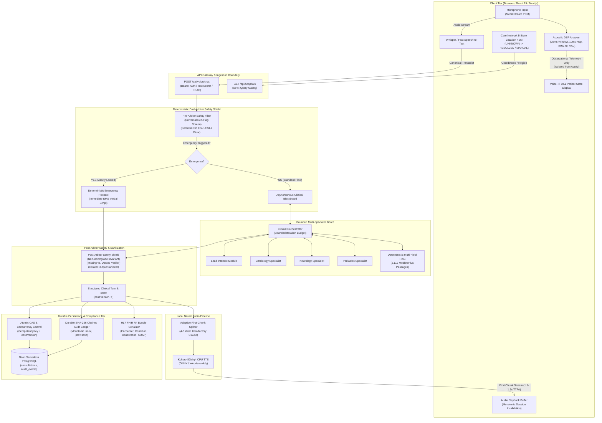

# MedVoice AI: System Architecture & Technical Design

> **Document Version:** 1.0  
> **Status:** Authoritative Engineering Architecture Specification  
> **Target Audience:** System Architects, Backend Engineers, Clinical Informaticists, Security Auditors  

---

## 1. System Overview

MedVoice AI is an investigational clinical voice triage and decision-support platform. It processes spoken patient utterances in real time, extracts structured clinical dimensions, checks against deterministic red-flag rules, orchestrates bounded specialist reasoning, and provides low-latency voice responses alongside durable, tamper-evident audit records.

The core architectural tenet of MedVoice is **strict bounded execution with deterministic safety authority**:
- Non-deterministic large language models (LLMs) **propose** hypotheses, clarify patient statements, and formulate conversational phrasing.
- Deterministic safety arbiters **dispose** and hold absolute authority over emergency triage levels, protocol triggers, and clinical safety constraints.
- Cryptographic hash-chained audit ledgers provide **immutable verification** of all state transitions, arbiter overrides, and clinical outputs.

---

## 2. End-to-End System Architecture



---

## 3. Core Subsystems & Components

### 3.1. Acoustic Paralinguistic DSP Analyzer (`lib/acoustic/`)
- **Pipeline**: Processes live microphone PCM streams via Web Audio API using **25 ms Hamming analysis windows** and **10 ms hop intervals**.
- **Extracted Features**:
  - Root-Mean-Square (RMS) amplitude and calibrated dBFS energy.
  - Voice Activity Detection (VAD) with energy thresholding (default: $-38\text{ dBFS}$) and speech run-length tracking.
  - Fundamental frequency ($f_0$) tracking via normalized autocorrelation.
  - Conversational pause cadence and speech rate estimation.
- **Architectural Isolation Boundary**: Paralinguistic acoustic metrics serve **strictly as observational UI telemetry and documentation metadata**. They are never routed into clinical decision trees or used as triage escalators.

### 3.2. Deterministic Dual-Arbiter Safety Shield (`lib/triage/`)
- **Pre-Arbiter (`evaluateUniversalRedFlags`)**: Evaluates incoming transcript tokens, patient demographic context, and known clinical history prior to any LLM execution.
  - Screens across 14 universal clinical red-flag categories (airway compromise, shock, BE-FAST stroke signs, acute coronary syndromes, infant fever, surgical abdomen).
  - Enforces an immediate emergency floor (MedVoice Tier 1/2 or ESI-1/2) upon matching life-threatening conditions.
- **Post-Arbiter (`evaluatePostArbiterSafety`)**: Inspects the candidate response, proposed differential, and state delta generated by downstream specialist modules.
  - **Non-Downgrade Invariant**: Deterministically guarantees that final acuity satisfies:
    $$\text{Acuity}_{\text{final}} = \min(\text{Acuity}_{\text{pre}}, \text{Acuity}_{\text{specialist}})$$
    Downstream LLM modules cannot override or de-escalate an active emergency floor.
  - **Missing vs. Denied Semantics**: Ensures unasked clinical dimensions are categorized as `unresolved`, preventing the LLM from assuming negative symptoms.
  - **Anti-Leakage & Sanitization**: Filters out internal system prompts, developer tokens, ungrounded diagnostic claims, or inappropriate medication prescriptions before client transmission.

### 3.3. Bounded Multi-Specialist Board & Clinical Blackboard (`lib/agents/`)
- **Implementation Reality (Heuristic Decision Modules)**: The specialist board operates as an in-memory heuristic coordination pattern. Specialist personas (Lead Internist, Cardiology, Neurology, Pediatrics, ENT) execute deterministic rule filters, slot extractors, and bounded prompt templates with simulated deliberation rounds. They do **not** function as autonomous, unconstrained LLM physician agents or concurrent independent cognitive entities.
- **Diagnostic & Clinical Scoring Tools (`lib/agents/tools/clinical-tools.ts`)**:
  - Scoring functions (e.g., TIMI, BE-FAST, NIHSS, PEWS criteria) are **software heuristic calculation rules** evaluating patient-reported symptoms, textual survey inputs, and self-reported vital ranges.
  - **Zero Sensor / Hardware Integration**: MedVoice has **no** direct hardware interface, no biological sensor connection, and **no 12-lead ECG hardware acquisition**. Any ECG-related parameters evaluate patient-reported verbal descriptors only and must never be treated as certified clinical biometric telemetry.
- **In-Memory Blackboard (`ClinicalBlackboard`)**: Acts as a synchronized, shared data structure where specialist decision modules post intermediate findings, hypothesis tags, and confidence scores across bounded iteration budgets (maximum 2 deliberation passes).

### 3.4. Deterministic Multi-Field Clinical RAG Engine (`lib/care-network/`, `lib/clinical-knowledge/`)
- **Local Knowledge Base**: 2,112 processed MedlinePlus clinical guideline passages and curated emergency practice guidelines stored locally.
- **Lexical Matching Formula**: Operates entirely in-memory using deterministic multi-field lexical token scoring:
  $$S(d, q) = \left( L_{\text{multi-field}}(d, q) + \Delta_{\text{domain}} \right) \times \gamma_{\text{section}} + \alpha_{\text{auth}}$$
  where:
  - $L_{\text{multi-field}}(d, q)$ calculates exact and fuzzy n-gram token overlap across title, keywords, and body text.
  - $\Delta_{\text{domain}}$ applies specialist-directed domain alignment bonuses.
  - $\gamma_{\text{section}}$ weights primary emergency indications over secondary background paragraphs.
  - $\alpha_{\text{auth}}$ enforces authority weighting for peer-reviewed guideline sources.
- **Offline Reliability**: Does not depend on external vector database endpoints or live third-party network APIs during triage evaluation.

### 3.5. Local Neural Audio Pipeline, STT Status & End-to-End Latency Profile (`lib/audio/`)
- **Speech-to-Text (STT) Infrastructure Status & Implementation**:
  - `/api/voice/stt` functions as an HTTP proxy bridge forwarding multipart audio payloads to the local FastAPI Whisper service (`FASTAPI_URL`, default: `http://127.0.0.1:8000/api/v1/stt`).
  - **ASR Engine & Dependencies**: The Python ASR service (`backend/services/audio_service.py`) utilizes **`openai-whisper`** (`whisper.load_model("base.en")`), **not** `faster-whisper`.
    - Required Python libraries: `openai-whisper`, `torch`, `fastapi`, `uvicorn`, `python-multipart`.
    - Required System dependencies: `ffmpeg` binary installed in system `PATH` for multi-format container decoding (`.webm`, `.wav`, `.ogg`, `.mp3`, `.m4a`).
  - **Cloud API Fallback Path**: If the local CPU Whisper model encounters an error or out-of-memory condition, an optional cloud fallback via the OpenAI Audio API (`whisper-1`) is triggered **if and only if** `OPENAI_API_KEY` is explicitly configured. If both local Whisper and cloud fallback fail (or no key is configured), an explicit `RuntimeError` is raised. The service **never** fabricates clinical symptoms or returns canned synthetic transcripts on failure.
  - **Service Requirement & Offline Behavior**: The FastAPI backend must be actively running (`uvicorn backend.main:app --port 8000`). If offline, `/api/voice/stt` returns `503 Service Unavailable` (`Local Whisper ASR service unavailable. Please ensure the backend is running.`), prompting the browser client to fall back to native Web Speech API or simulated transcript input.
  - **Current Production Blocker**: Live end-to-end STT latency, browser media recorder chunking, and handling of empty transcript edge cases remain an active engineering blocker and work in progress.
- **Adaptive First-Chunking & TTS Pipeline**:
  - Splits conversational turns into an immediate introductory clause (4–8 words) and subsequent paragraphs.
  - Synthesizes the initial clause through local Kokoro-82M q4 CPU ONNX neural TTS while remaining speech sentences are scheduled.
- **Disentangled Latency Profile (Component vs. Full Pipeline Reality)**:
  - *Safety Arbiter Latency*: **0.39 ms mean** (P50: **0.14 ms**) — purely in-memory deterministic rule evaluation.
  - *Deterministic Lexical RAG*: **4.2 ms mean** (P95: **8.1 ms**) — in-memory lexical scoring across 2,112 passages.
  - *Local Whisper ASR (CPU base.en)*: **1.0–2.5 s** warm transcription for short clinical utterances (cold start: 1.5–3.0 s, initial model load: ~2–4 s).
  - *Kokoro-82M CPU TTS First-Chunk*: **1.1–1.6 seconds** TTFA for introductory clauses.
  - *Full End-to-End Conversational Turnaround*: In a live voice session involving user microphone capture, external ASR transcription, cloud LLM synthesis (Groq/NVIDIA), and audio delivery, end-to-end turnaround is **2.5–5.0+ seconds**. Sub-second turnaround applies **strictly** to local deterministic safety pre-arbiter checks and pre-cached emergency alerts. The full voice pipeline does **not** meet sub-second targets.
- **Monotonic Barge-In Cancellation**: Tracks audio playback via incrementing monotonic session tokens. When user speech interruption or VAD activity is detected, the current token is invalidated immediately, halting playback and clearing queued audio buffers.

---

## 4. Trust Boundaries & Security Model

MedVoice establishes explicit boundaries between untrusted inputs, AI reasoning, and authoritative records:

```mermaid
flowchart LR
    subgraph Untrusted["Zone 0: Untrusted / External"]
        Caller["Patient Voice / Spoken Input"]
        BrowserEnv["Client Browser Environment"]
    end

    subgraph SemiTrusted["Zone 1: Bounded AI Reasoning"]
        ASRTranscription["ASR Transcription"]
        LLMInference["Specialist LLMs (Groq / NVIDIA)"]
        BlackboardMem["In-Memory Blackboard"]
    end

    subgraph Trusted["Zone 2: Authoritative Enforcement"]
        Arbiter["Deterministic Safety Arbiters"]
        RBAC["RBAC & Session Ownership (Clerk / Internal Secret)"]
        Ledger["SHA-256 Chained Audit Ledger"]
        Postgres[("Authoritative PostgreSQL Database")]
    end

    Caller -->|"Raw Audio"| BrowserEnv
    BrowserEnv -->|"HTTP POST (Bearer Auth)"| Route["API Gateway"]
    Route -->|"Transcript Text"| SemiTrusted
    SemiTrusted -->|"Proposed Turn / Acuity"| Arbiter
    Arbiter -->|"Enforced Invariants"| Trusted
    Trusted -->|"State Mutation"| Postgres
    Trusted -->|"Signed Event"| Ledger
```



### Trust Boundary Policies
1. **Patient Utterance Boundary**: Spoken text is unverified subjective reporting. It cannot directly mutate clinical diagnosis codes, set verified vital signs, or bypass safety screens.
2. **LLM Output Boundary**: Outputs from LLM models are treated as unverified candidate proposals. They are intercepted by the Post-Arbiter before being delivered to the user or committed to the database.
3. **Observational Telemetry Boundary**: Browser acoustic measurements (pitch, volume, speech tempo) are isolated from clinical risk scoring. They are never permitted to elevate or depress triage acuity.
4. **Administrative & Clinician Authority Boundary**: Consultations created during telephone intake transition to `completed_pending_review`. Only an authenticated clinician with appropriate RBAC roles (`clinician` or `admin`) can advance an encounter to `approved`.

---

## 5. Encounter-State Ownership & Concurrency

### 5.1. Server-Authoritative State
Encounter state is maintained on the server within `consultationsTable.interviewState` (`ClinicalInterviewState`). The client receives state snapshots but is not authoritative over encounter state transitions:
- `phase`: Current interview phase (`initial_intake`, `active_inquiring`, `red_flag_screening`, `emergency_divert`, `differential_synthesis`, `completed`).
- `caseVersion`: Monotonically incrementing integer representing the authoritative sequence of conversational turns.
- `slots`: Extracted clinical entities (location, onset, severity, character, radiation, aggravating/alleviating factors, associated symptoms).
- `conversationMemory`: Provenance-tracked lists of `confirmedFacts`, `deniedSymptoms`, `patientCorrections`, and `askedTopics`.

### 5.2. Optimistic Concurrency & CAS Semantics
To prevent state clobbering from rapid multi-tab clicks or network retries, all consultation state mutations enforce Compare-And-Swap (CAS) optimistic concurrency:
```sql
UPDATE consultations
SET interview_state = $1, case_version = case_version + 1, updated_at = NOW()
WHERE id = $2 AND case_version = $3;
```
If the supplied `caseVersion` does not match the database state, the update is rejected with an HTTP `409 Conflict`, prompting the client to synchronize with current server state.

### 5.3. Idempotency Guarantees
Intake turn submissions supply a client-generated UUID `idempotencyKey`. The PostgreSQL schema enforces this via a partial unique index:
```sql
CREATE UNIQUE INDEX idx_consultations_user_idempotency_unique
ON consultations (user_id, idempotency_key)
WHERE idempotency_key IS NOT NULL;
```
Duplicate submissions with identical keys resolve idempotently without re-executing inference pipelines or creating phantom audit events.
