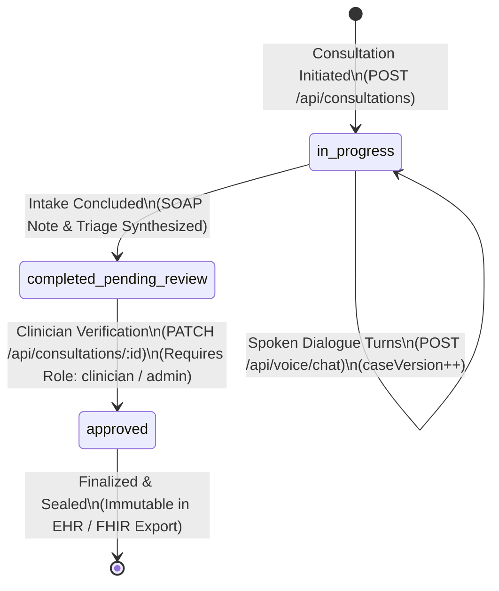

# MedVoice AI: Data Architecture, State Lifecycle & Durable Persistence

> **Document Version:** 1.0  
> **Status:** Authoritative Persistence & Compliance Specification  
> **Target Audience:** Database Engineers, Compliance Officers, Security Architects, Backend Engineers  

---

## 1. Overview & Storage Architecture

MedVoice utilizes a hybrid persistence architecture combining relational PostgreSQL storage, cryptographic audit chains, and structured HL7® FHIR® document bundles:
- **Primary Database Engine**: [Neon Serverless PostgreSQL](https://neon.tech/) with pooled connection management.
- **ORM & Schema Definition**: [Drizzle ORM](https://orm.drizzle.team/) with typed TypeScript schemas in `config/schema.ts`.
- **Integrity Layer**: Durable SHA-256 cryptographic audit ledger (`audit_events` table).
- **Interoperability Standard**: HL7® FHIR® R4 document serialization (`Patient`, `Encounter`, `Condition`, `Observation`, `Composition`).

---

## 2. Consultation & Encounter Lifecycle

Consultation encounters progress through an explicit three-stage lifecycle:



### Stage Definitions & Transition Rules

1. `in_progress`:
   - Active telephone intake session.
   - Spoken utterances are processed through ASR, deterministic safety arbiters, and specialist agents.
   - Clinical state (`ClinicalInterviewState`), delivered turns, and attributed facts are incrementally updated.
   - Updates must supply valid `idempotencyKey` and match the current `caseVersion`.

2. `completed_pending_review`:
   - Patient voice intake has concluded, or an emergency escalation occurred.
   - Full SOAP clinical note (`soapSubjective`, `soapObjective`, `soapAssessment`, `soapPlan`) and triage recommendations are synthesized.
   - The encounter is locked from further patient modifications.
   - Status remains pending until an authorized human clinician reviews the encounter.

3. `approved`:
   - A credentialed clinician reviews the transcript, clinical state, and proposed SOAP notes.
   - Clinician applies any necessary corrections and records clinical sign-off (`approvedBy`, `approvedAt`).
   - The consultation transitions to `approved` and is signed into the audit ledger with action `CONSULTATION_APPROVED`.
   - The record becomes immutable. Downstream HL7 FHIR R4 document bundles generated from this state represent authoritative clinical records.

---

## 3. Durable SHA-256 Chained Audit Ledger

### 3.1. Mathematical Formulation & Block Structure
Every security-critical and clinical event is hashed and chained into the `audit_events` ledger (`lib/audit/audit-logger.ts`). Each event block is cryptographically linked to the previous block:

$$\text{EventHash}_i = \text{SHA-256}\left( \text{index}_i \,\|\, \text{id}_i \,\|\, \text{timestamp}_i \,\|\, \text{actorId}_i \,\|\, \text{actorRole}_i \,\|\, \text{action}_i \,\|\, \text{resourceType}_i \,\|\, \text{resourceId}_i \,\|\, \text{status}_i \,\|\, \text{previousHash}_i \,\|\, \text{JSON}(\text{sortedMetadata}_i) \right)$$

where:
- Block 0 uses the constant $\text{GENESIS\_HASH} = \text{"0000000000000000000000000000000000000000000000000000000000000000"}$.
- Metadata keys are sorted deterministically prior to JSON serialization to guarantee reproducible hash values across environments.
- Monotonic `index` strictly increments: $\text{index}_i = \text{index}_{i-1} + 1$.

### 3.2. Audited Actions
The audit ledger records the following discrete events:
- `CONSULTATION_CREATED`: Initial intake session initialization.
- `CONSULTATION_UPDATED`: Dialogue turn committed or clinical state updated.
- `CONSULTATION_APPROVED`: Clinician review and official approval.
- `CONSULTATION_ACCESSED`: Access to consultation record (HIPAA access tracking).
- `CONSULTATION_OVERRIDE`: Clinician modification to an automated triage suggestion.
- `TRIAGE_EVALUATION`: Deterministic safety arbiter evaluation and red-flag trigger.
- `EMERGENCY_DISPATCH`: Emergency escalation triggered and hospital routing initiated.
- `AUDIT_CHAIN_VERIFIED`: Full-chain integrity verification scan.
- `ACCESS_DENIED`: Unauthorized access attempt blocked by RBAC or IDOR guard.
- `ROLE_ELEVATION_ATTEMPT`: Suspicious role escalation attempt intercepted.
- `PATIENT_PROFILE_SAVED` / `PATIENT_PROFILE_DELETED`: Patient demographic updates or DPDP right-to-be-forgotten invocations.

### 3.3. Tamper Detection & Verification
The ledger includes an automated integrity verification routine (`verifyAuditChain()`):
- Traverses the entire audit sequence in ascending order of `index`.
- Recalculates $\text{EventHash}_i$ from raw columns and compares against stored hash.
- Verifies that $\text{previousHash}_i == \text{EventHash}_{i-1}$.
- If any discrepancy is detected, verification immediately fails, identifying the exact corrupted index and halting further operations.

---

## 4. Concurrency Control & Idempotency

### 4.1. Optimistic Concurrency via Case Versioning
Concurrent edits to consultation records (e.g. rapid audio chunk uploads or race conditions during network reconnection) are managed via Compare-And-Swap (CAS) optimistic locking:
- `consultationsTable.caseVersion` begins at `1` and increments with each successful turn.
- State mutation queries require the caller to submit the expected `caseVersion`:
  ```sql
  UPDATE consultations
  SET 
    interview_state = ${newState},
    delivered_turn_records = ${newTurns},
    case_version = case_version + 1,
    updated_at = NOW()
  WHERE id = ${consultationId} AND case_version = ${expectedVersion};
  ```
- If zero rows are affected, a version conflict occurred. The server rejects the request with HTTP `409 Conflict` and rolls back state.

### 4.2. Database Unique Constraint Idempotency
To prevent duplicate consultation records or replayed requests from generating duplicate billing, transcripts, or audit entries, each consultation submission requires an `idempotencyKey` UUID generated by the client.
The PostgreSQL schema enforces this via a partial unique index:
```sql
CREATE UNIQUE INDEX idx_consultations_user_idempotency_unique
ON consultations (user_id, idempotency_key)
WHERE idempotency_key IS NOT NULL;
```
If a duplicate request is received, the database triggers a unique constraint violation (`23505`), which the API catches to return the existing consultation record safely.

---

## 5. Drizzle ORM Schema & Migration Workflow

### 5.1. Table Overview (`config/schema.ts`)
- `consultationsTable`: Stores clinical dialogue transcripts, SOAP notes, triage levels, and serialized `ClinicalInterviewState`.
- `auditEventsTable`: Stores the tamper-evident cryptographic hash chain.
- `patientProfilesTable`: Stores longitudinal patient demographics, medical history, allergies, and DPDP Act consent status.
- `hospitalsTable`: Stores emergency facilities with ABDM HFR IDs, coordinates, ratings, and verified 24x7 emergency capabilities.
- `clinicalKnowledgePassagesTable`: Stores 2,112 offline MedlinePlus passages with topic IDs, section metadata, and lexical search keywords.
- `doctorProfilesTable`: Stores specialist personas, clinical credentials, and avatars.

### 5.2. Migration Commands
Drizzle ORM manages database schema evolutions. Migrations are executed via npm scripts:

```bash
# Generate SQL migration files from changes in config/schema.ts
npx drizzle-kit generate

# Apply pending migrations to the configured database
npx drizzle-kit migrate

# Inspect or debug live tables using Drizzle Studio GUI
npx drizzle-kit studio
```

### 5.3. Connection Pooling & Offline Resilience
The database connection manager (`config/db.ts`) provides connection pooling for serverless environments:
- **Neon Serverless**: Connects via `@neondatabase/serverless` using pooled WebSocket/HTTP connections, preventing connection exhaustion during concurrent traffic spikes.
- **Offline / Development Fallback**: If `DATABASE_URL` is omitted (e.g. during offline test execution or local UI development), the data layer automatically falls back to an in-memory repository without throwing unhandled exceptions.

---

## 6. Privacy & Healthcare Compliance Safeguards

### 6.1. DPDP Act (India) Compliance
- **Explicit Consent Tracking**: `patientProfilesTable` enforces `consentGiven` boolean and `consentTimestamp`.
- **Right to Erasure (Soft-Delete)**: When a patient requests profile deletion, records are marked `isDeleted = true` and `deletedAt = NOW()`, purging active clinical context while retaining cryptographically necessary audit ledger indexes for legal compliance.
- **Data Minimization**: Demographics prefer `yearOfBirth` over full date of birth.

### 6.2. HIPAA Technical Safeguards (45 CFR § 164.312)
- **Transmission Security**: All database connections mandate `sslmode=require`.
- **Access Control & RBAC**: Row-level ownership validation (IDOR prevention) verifies that caller `userId` matches the consultation owner, unless the caller holds the `clinician` or `admin` role.
- **Audit Integrity**: Cryptographic chain linking prevents retrospective modification or selective deletion of intake logs.
