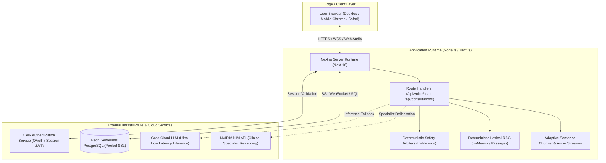

# MedVoice AI: Operations, Deployment & Runtime Guide

> **Document Version:** 1.0  
> **Status:** Authoritative Operational Specification  
> **Target Audience:** DevOps Engineers, Site Reliability Engineers, System Administrators, Security Engineers  

---

## 1. System Topology & Infrastructure Overview

MedVoice AI is architected as a Next.js 16 (App Router) full-stack application running on Node.js (v18.18+ or v20/v22 LTS), integrating serverless managed services for authentication and database persistence:



---

## 2. Environment Configuration & Secrets Management

All environment configurations are loaded from system environment variables or `.env.local` for local development.

### 2.1. Required Configuration Matrix

| Variable Name | Required In | Sensitivity | Purpose & Description |
| :--- | :---: | :---: | :--- |
| `DATABASE_URL` | Production | **Critical** | Connection string for Neon Serverless PostgreSQL with SSL required (`sslmode=require`). Backs the durable SHA-256 audit ledger and consultation records. |
| `NEXT_PUBLIC_CLERK_PUBLISHABLE_KEY` | All | Public | Clerk public key used by frontend UI components (`pk_test_...` or `pk_live_...`). Safe to expose to browsers. |
| `CLERK_SECRET_KEY` | All | **Critical** | Server-side secret key used to verify session tokens and enforce Role-Based Access Control (RBAC). Must **never** be prefixed with `NEXT_PUBLIC_`. |
| `GROQ_API_KEY` | Production | High | API key for high-speed conversational dialogue synthesis via Groq Cloud. |
| `NVIDIA_API_KEY` | Production | High | API key for multi-specialist clinical reasoning models via NVIDIA NIM. |
| `ASSEMBLYAI_API_KEY` | Optional | Medium | Server-only key for cloud speech-to-text fallback. |
| `INTERNAL_TEST_HARNESS_SECRET` | Testing | High | Shared secret required by automated test suites to simulate RBAC roles safely during CI/CD. |

> [!CAUTION]
> **Secret Leakage Prevention**: Never prefix `CLERK_SECRET_KEY`, `DATABASE_URL`, `GROQ_API_KEY`, or `NVIDIA_API_KEY` with `NEXT_PUBLIC_`. Build and CI lint scripts actively check against client-side bundling of private secrets.

---

## 3. Latency Benchmarks, SLAs & Pipeline Realities

### 3.1. Disentangled Component Benchmarks vs. End-to-End Latency Reality
MedVoice achieves conversational fluency by separating deterministic safety evaluation from slow generative audio synthesis. However, component-level benchmarks must not be conflated with full-pipeline voice turnaround:

| Metric / Pipeline Stage | Scope | Measured Baseline | Operational Reality & Limitations |
| :--- | :---: | :---: | :--- |
| **Safety Arbiter Latency** | Component (Isolated) | **0.39 ms mean** (P50: **0.14 ms**) | In-memory compiled regular expressions and decision trees; zero network I/O. |
| **Deterministic Lexical RAG** | Component (Isolated) | **4.2 ms mean** (P95: **8.1 ms**) | In-memory token index over 2,112 curated MedlinePlus passages; zero vector DB overhead. |
| **Local Whisper ASR (CPU base.en)** | Component (Isolated) | **1.0–2.5 s warm** (cold: 1.5–3.0 s) | CPU inference on 74M parameter model; requires external FastAPI backend and ffmpeg. |
| **Time-to-First-Audio (TTFA)** | Speech Synthesis Only | **1.1–1.6 s** (compound turns) | **Adaptive First-Chunking**: Immediately synthesizes introductory 4–8 words via Kokoro-82M q4 CPU while subsequent sentences queue. |
| **Audio Starvation Between Chunks** | Playback Buffer | **0.0 ms measured** | Audio playback buffer queues subsequent PCM chunks before the first finishes playing. |
| **Barge-In Interruption Latency** | Client Interruption | **< 40 ms** | Client-side monotonic session token invalidation: immediately clears queued buffers upon VAD activity. |
| **Full End-to-End Voice Turnaround** | Full Pipeline (Mic $\rightarrow$ Speaker) | **2.5–5.0+ s** | Involves client audio recording, Whisper ASR transit, remote cloud LLM generation (Groq/NVIDIA), neural TTS synthesis, and audio buffering. **Sub-second turnaround applies STRICTLY to local pre-arbiter checks and pre-cached alerts, not full generative turns.** |

### 3.2. Speech-to-Text (STT) Infrastructure Status & Blockers
- **Local Whisper Bridge (`/api/voice/stt`)**: Proxies audio multipart payloads to the external FastAPI Whisper service (`FASTAPI_URL`, default: `http://127.0.0.1:8000/api/v1/stt`).
- **ASR Engine & Dependencies**: The Python ASR service (`backend/services/audio_service.py`) relies on **`openai-whisper`** (`whisper.load_model("base.en")`), **not** `faster-whisper`.
  - Python runtime: Python 3.10+, `torch`, `openai-whisper`, `fastapi`, `uvicorn`, `python-multipart`. It is **not bundled or self-contained within the Node.js / Next.js runtime**.
  - System runtime: `ffmpeg` binary installed in system `PATH` for decoding audio streams.
- **Cloud Fallback Path**: If local Whisper encounters an error or out-of-memory failure on CPU, an optional cloud fallback to the OpenAI Audio API (`whisper-1`) executes if and only if `OPENAI_API_KEY` is provided. If both fail or no key is present, an explicit error is returned. The service **never** returns fabricated clinical symptoms or synthetic transcripts.
- **Service Requirement & Development Reality**:
  - The FastAPI backend must be running (`uvicorn backend.main:app --port 8000`). If offline, `/api/voice/stt` returns `503 Service Unavailable`.
  - In local development without the Python process running, browser clients rely on native Web Speech API or simulated transcript injection.
  - Production release requires containerizing and deploying the Python Whisper ASR service as an independent microservice with GPU or multi-core CPU compute.
  - **Active Blocker**: Live browser recording, stream chunking, and handling of empty transcript edge cases remain an active engineering blocker and work in progress. Full voice pipeline turnaround does not achieve sub-second latency.

---

## 4. Failure Modes, Resilience & Recovery Procedures

### 4.1. Remote PostgreSQL Outage / Connection Exhaustion
- **Symptom**: `DATABASE_URL` is unreachable or times out during high concurrency.
- **Development / Test Behavior**: Automatically logs a warning and falls back to an in-memory audit store, allowing offline testing and UI development to proceed.
- **Production Behavior**: Read operations serve cached profiles; write operations fail closed (`503 Service Unavailable`) for state mutations to prevent clinical data loss or un-audited encounter drift.
- **Recovery Procedure**:
  1. Inspect Neon console metrics for connection pooling limits or compute suspension.
  2. Verify that `DATABASE_URL` contains `channel_binding=require` and pooled endpoint parameters.
  3. Once connectivity is restored, trigger `verifyAuditChain()` via `/api/audit` to confirm zero hash chain corruption.

### 4.2. External LLM Provider Rate Limiting (HTTP 429) or Outage
- **Symptom**: Groq or NVIDIA NIM APIs return 429 Too Many Requests or 5xx errors.
- **Safety Guarantee**: The **Pre-Arbiter runs before any LLM API call**. If a patient utters an emergency phrase (e.g. "severe chest pain", "slurred speech"), the emergency protocol triggers deterministically without ever contacting the LLM.
- **Non-Emergency Fallback**: For routine dialogue turns where the LLM is unreachable, the system returns a safe clinical fallback asking the patient to repeat their symptom or offers to connect with clinic staff directly.

### 4.3. High-Rate Dialogue Retries & Concurrency Clashing
- **Symptom**: User double-clicks speech buttons or experiences intermittent network reconnections, sending overlapping requests.
- **Mitigation**:
  - Compare-And-Swap (CAS) optimistic concurrency on `caseVersion`: the out-of-order request receives `409 Conflict` and does not clobber newer state.
  - Unique constraint on `(userId, idempotencyKey)` ensures duplicate requests return the cached turn response.

---

## 5. Production Release Gates & Verification Checklist

Before deploying any release candidate to a staging or production environment, the following automated release gates must pass:

1. **TypeScript Type Safety**:
   ```bash
   npx tsc --noEmit
   ```
   Must exit with code 0 and zero type errors.

2. **Next.js & ESLint Verification**:
   ```bash
   npm run lint
   ```
   Must exit with code 0 and zero lint warnings or errors.

3. **Deterministic Test Battery & Real Coverage**:
   ```bash
   npm run test:coverage
   ```
   - Must run all 41 canonical test suites.
   - Must generate valid `coverage/lcov.info` and `coverage/cobertura-coverage.xml`.
   - Must satisfy empirical thresholds:
     - Lines: $\ge 60.0\%$
     - Branches: $\ge 65.0\%$
     - Functions: $\ge 75.0\%$
     - Statements: $\ge 60.0\%$

4. **Dedicated PostgreSQL Integration Harness**:
   ```bash
   npm run test:db
   ```
   When `DATABASE_URL` is configured, verifies live PostgreSQL tables, CAS concurrency, and audit ledger integrity. (Explicitly reports `SKIPPED` when unconfigured).

5. **Production Build Compilation**:
   ```bash
   npm run build
   ```
   Must produce static and dynamic server routes without bundling errors or secret leakages.
