# MedVoice — Synthetic Stakeholder Demonstration & Governance Guide

> **Target Audience**: Clinical Directors, Hospital Ethics Reviewers, Technical Security Auditors, and Institutional Stakeholders
>
> **Classification**: Investigational Clinical Decision-Support & Ambient Voice Documentation System
>
> **Executable Command**: `npm run demo:stakeholder`
>
> **Source Harness**: [`scripts/run-synthetic-stakeholder-demo.ts`](file:///c:/dev/Capstone/scripts/run-synthetic-stakeholder-demo.ts)

---

> [!IMPORTANT]
> **Clinical & Regulatory Scope Notice**:
> All patient encounters, clinical presentations, and triage dialogues in this demonstration are **synthetic test fixtures**.
> Automated software test passes demonstrate deterministic software behaviors and security boundaries. They do **NOT** establish clinical diagnostic efficacy, real-world ESI triage accuracy, or clinical sensitivity, nor do they constitute medical device accreditation. No real emergency services dispatch occurs.

---

## 1. Executive Summary

This document outlines the **Synthetic Stakeholder Demonstration (P1.4)** for MedVoice. It synthesizes the foundational safety, durability, rate-limiting, and tamper-resistance mechanisms implemented across **Phase 1 (P1.1 – P1.3)** into an automated, reproducible, and verifiable demonstration.

The demonstration does **NOT** rely on mock assertions or non-deterministic large language model responses. Every scenario runs against the platform's core algorithmic engines, cryptographic verifiers, and concurrency controllers to verify safety and data integrity behaviors under adverse conditions.

```mermaid
flowchart TD
    subgraph S1["Scenario 1: Clinical Safety"]
        A1["Synthetic Patient Utterance"] --> B1["Deterministic Preflight Rules (In-Process)"]
        B1 --> C1["Mock ESI-1/2 Directive"]
        B1 -.->|Tested Path Excludes| D1["LLM Generation"]
    end

    subgraph S2["Scenario 2: Sliding-Window Rate Limiting"]
        A2["Abusive Traffic / Store Outage"] --> B2["Sliding Window Log (Memory Test Adapter)"]
        B2 --> C2["RFC 6585 429 Response"]
        B2 -->|Urgent Symptoms| D2["Emergency Preflight Bypass (Zero LLM/TTS)"]
    end

    subgraph S3["Scenario 3: Atomic CAS Fencing"]
        A3["Simultaneous Clinician Updates"] --> B3["Optimistic Check-and-Set (CAS)"]
        B3 --> C3["Winner: Version Advanced"]
        B3 --> D3["Loser: HTTP 409 Conflict (Zero Dirty Writes)"]
    end

    subgraph S4["Scenario 4: Cryptographic Trust Anchor"]
        A4["Database Hash Chain"] --> B4["Signed External Checkpoint"]
        C4["Adversary Recalculates DB Chain"] --> D4["Detached Vault WORM Simulation Exposes Rewrite"]
    end

    subgraph S5["Scenario 5: Multi-Tenant Zero-Trust"]
        A5["Cross-Tenant Read/Write"] --> B5["Strict Server-Side Identity Isolation"]
        B5 --> C5["HL7 FHIR R4 Bundle Export"]
    end
```



---

## 2. Five Controlled Demonstration Scenarios

### Scenario 1: Deterministic Emergency Preflight without LLM Generation
- **Synthetic Persona**: Marcus Vance (56M), presenting with acute crushing retrosternal pressure radiating down left arm with profuse diaphoresis.
- **Tested Path**: Evaluates the deterministic regex safety preflight (`evaluatePreArbiter` in [`lib/triage/pre-arbiter.ts`](file:///c:/dev/Capstone/lib/triage/pre-arbiter.ts)).
- **Verified Software Behavior**:
  - The deterministic preflight check evaluates the transcript synchronously in **$<1.0\text{ ms}$** (measured locally via in-process microbenchmark).
  - Automatically identifies deterministic rule flags: `PRE_FLAG_ACUTE_CHEST_PAIN` and `PRE_FLAG_ACS_RADIATION_OR_DIAPHORESIS`.
  - Generates mock pre-arrival emergency directives without LLM generation in the tested path.
  - *Distinction*: This verifies that the rule engine executes synchronously without stochastic generation; it does not constitute clinical trial evidence of diagnostic sensitivity.

---

### Scenario 2: Sliding-Window Rate Limiting & Healthcare Safety Invariant
- **Target Subsystem**: Multi-node abuse prevention and resource capping.
- **Environment Tested**: In-process [`MemoryRateLimitStore`](file:///c:/dev/Capstone/lib/security/distributed-rate-limiter.ts) test adapter. Production multi-instance deployments connect to an authoritative Upstash Redis REST instance.
- **Verified Software Behavior**:
  - Enforces route-specific quotas via sliding-window logs (`VOICE_CHAT`: 30 req / 60s).
  - Rejects the 31st request with RFC 6585 `HTTP 429 Too Many Requests` headers (`Retry-After: 60s`, `X-RateLimit-*`).
  - **Adversarial Spoofing Defense**: Client-asserted emergency flags (`isEmergency: true`, `x-emergency: true`) on non-emergency text are strictly rejected with 429.
  - **Healthcare Safety Invariant**: If a throttled patient presents acute stroke signs (*"Doctor, my mother suddenly has right-sided facial droop and cannot speak or move her arm!"*), the preflight permits immediate emergency directives while **strictly suppressing downstream expensive compute** (Kokoro neural TTS and LLM reasoning are not dispatched).
  - **Zero-PII Keyspace**: Redis keys are formatted as `rl:voice_chat:usr:<16-char-sha256>`, guaranteeing that zero patient IDs or raw IPs leak into shared memory caches.

---

### Scenario 3: Atomic Concurrency CAS Fencing & Idempotency
- **Synthetic Encounter**: Consultation `MED-2026-ACS-8841` at datastore version `v1`.
- **Threat Mitigated**: Race conditions where concurrent clinicians or overlapping automated voice turns overwrite clinical assessments (lost updates and dirty writes).
- **Verified Software Behavior**:
  - Two simulated clinician sessions (Clinician A and Clinician B) attempt concurrent approvals based on initial version `v1`.
  - Clinician A succeeds: CAS check `version === 1` matches; datastore advances to `version = 2` with status `'approved'`.
  - Clinician B fails: CAS check `version === 1` mismatches current datastore state (`v2`); update is aborted with `HTTP 409 Conflict` (`CONCURRENCY_CONFLICT`).
  - Single-flight turn idempotency ensures identical acoustic audio chunk submissions return cached turn allocations without duplicate billing or double-execution.

---

### Scenario 4: Audit Ledger Integrity & Detached Vault WORM Simulation
- **Threat Mitigated**: Compromised database administrator or malicious SQL injection altering historic clinical findings and recalculating SHA-256 chain hashes to fake authenticity.
- **Environment Tested**: In-process [`DetachedVaultCheckpointStore`](file:///c:/dev/Capstone/lib/audit/checkpoint.ts) with filesystem-level file-locked WORM emulation.
- **Notice on Production Deployments**: This test verifies algorithmic tamper-detection against recalculated chains. It does not verify live AWS S3 Object Lock compliance mode or KMS HSM hardware key protection, which remain documented as **BLOCKED** pending a disposable AWS test bucket.
- **Verified Software Behavior**:
  - A 4-event consultation lifecycle (`CONSULTATION_CREATED` $\to$ `TRIAGE_EVALUATION` $\to$ `EMERGENCY_DISPATCH` $\to$ `CONSULTATION_APPROVED`) is generated with SHA-256 hash chaining.
  - A cryptographic HMAC-SHA256 checkpoint (`CHK-...`) is minted and committed to the external vault store.
  - **Attack Simulation**: An adversary modifies Event 1 (downgrading ESI 1 to ESI 4) and recalculates subsequent event hashes.
  - **Detection**: Ordinary internal chain validation accepts the recalculated ledger because hashes link sequentially. However, verifying against the external detached vault anchor immediately triggers `REWRITTEN_LEDGER_DETECTED`, permanently unmasking the intrusion.

---

### Scenario 5: Zero-Trust Multi-Tenant Isolation & HL7 FHIR Export
- **Threat Mitigated**: Insecure Direct Object References (IDOR) allowing patient tenants to inspect or tamper with another patient's clinical chart.
- **Verified Software Behavior**:
  - Server-side session verification enforces strict tenant ownership boundaries across all consultation routes; cross-tenant reads or writes fail closed with `403 Forbidden` / `404 Not Found`.
  - Export generates an HL7 FHIR R4 document Bundle containing `Patient`, `Condition` (standard ICD-10 `I21.9`), `Composition` (standard LOINC `11488-4` Consultation note), and `Observation`.
  - **Terminology Clarity**: Acoustic vocal perturbation features use the project-specific CodeSystem (`https://medvoice.health/fhir/CodeSystem/acoustic-metrics` with code `acoustic-perturbation-index`). It is explicitly documented as a project-specific metric, not an established LOINC concept.

---

## 3. How to Run the Demonstration

To execute the demonstration suite locally:

```bash
# Execute synthetic stakeholder demonstration suite
npm run demo:stakeholder
```

### Expected Output
```text
========================================================================================
  EXECUTIVE STAKEHOLDER DEMONSTRATION SUMMARY
========================================================================================

  🟢 PASS : Scenario 1: Clinical Safety Preemption
  🟢 PASS : Scenario 2: Distributed Rate Limiting
  🟢 PASS : Scenario 3: Concurrency CAS Fencing
  🟢 PASS : Scenario 4: Cryptographic Tamper Detection
  🟢 PASS : Scenario 5: Multi-Tenant RBAC & FHIR

  Final Score: 5 / 5 Scenarios Fully Validated
========================================================================================
```

---

## 4. Operational & Institutional Pilot Gate Alignment

This demonstration directly illustrates the technical controls for **Gate A (Technical & Architectural Security)** and provides software evidence for **Gate B (Clinical Validation)** under [`docs/PILOT_READINESS.md`](file:///c:/dev/Capstone/docs/PILOT_READINESS.md):

| Governance Gate | Requirement | Demonstration Evidence | Test Infrastructure Used |
| :--- | :--- | :--- | :--- |
| **Gate A: Technical** | Multi-tenant IDOR protection | **Scenario 5**: Strict server-side tenancy enforcement verified under hostile caller simulation. | In-memory synthetic tenant simulation |
| **Gate A: Technical** | Tamper-evident audit anchoring | **Scenario 4**: External checkpoint exposing full-ledger database recalculation rewrites. | DetachedVault WORM emulation (Live S3 BLOCKED) |
| **Gate A: Technical** | Distributed rate limiting | **Scenario 2**: Sliding-window log with zero-PII key derivation. | In-memory test store (`MemoryRateLimitStore`) |
| **Gate A: Technical** | Concurrency durability | **Scenario 3**: CAS check-and-set preventing lost updates on clinical chart modifications. | In-memory simulated record CAS |
| **Gate B: Clinical** | Deterministic ESI Urgency | **Scenario 1**: In-process rule preflight executed without LLM generation. | Local regex microbenchmark (<1ms) |
| **Gate B: Clinical** | Clinical Provenance & FHIR | **Scenario 5**: HL7 FHIR R4 Bundle with ICD-10 and project-specific acoustic biomarker coding. | Structured JSON schema validator |
