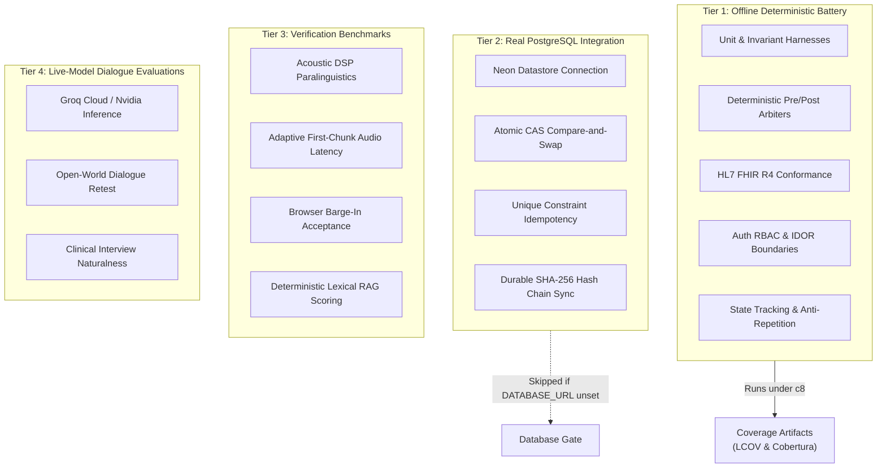
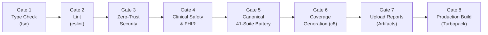

# 🧪 MedVoice AI — Engineering Testing & Coverage Specification

> **Authoritative guide to test suites, deterministic evaluation harnesses, coverage reporting, datastore verification, and CI governance in MedVoice AI.**

---

## 📑 Table of Contents

1. [Testing Architecture & Tier Classification](#1-testing-architecture--tier-classification)
2. [Test Suite Inventory & Categorization](#2-test-suite-inventory--categorization)
3. [Test Execution Commands](#3-test-execution-commands)
4. [Coverage Reporting & Measured Baseline](#4-coverage-reporting--measured-baseline)
   - [Tooling & Source-Map Attribution](#tooling--source-map-attribution)
   - [Scoping & Exclusions](#scoping--exclusions)
   - [Empirical Coverage Baseline](#empirical-coverage-baseline)
   - [Enforcement Thresholds & Rationale](#enforcement-thresholds--rationale)
5. [Database Verification & Explicit Skip Behavior](#5-database-verification--explicit-skip-behavior)
6. [Continuous Integration (CI) Pipeline Architecture](#6-continuous-integration-ci-pipeline-architecture)
7. [Known Test Gaps & Uncovered Paths](#7-known-test-gaps--uncovered-paths)

---

## 1. Testing Architecture & Tier Classification

MedVoice AI separates testing into four distinct operational tiers to prevent test pollution, rate-limit flakiness, and false claims of infrastructure verification:



### Core Testing Invariants
1. **Deterministic Execution by Default**: Offline test suites must run without live network calls to third-party LLM APIs (Groq, Nvidia) or external databases. Test environments must mock or fall back deterministically.
2. **Explicit Database Skip Reporting**: Tests requiring a live PostgreSQL instance (e.g. `atomic-concurrency-idempotency.test.ts`) must detect whether `DATABASE_URL` is set. When unset, they must explicitly log a `SKIPPED` warning and must never be represented as successful database integration.
3. **Fail-Fast Error Propagation**: The test runner must capture child process exit codes and halt execution immediately if any invariant check fails.

---

## 2. Test Suite Inventory & Categorization

The repository contains **54 test scripts** defined in `package.json`, organized into the following functional domains:

### A. Zero-Trust Security, Auth RBAC & Tenant Isolation
| Script Command | Target Source File | Test Mechanism |
|---|---|---|
| `npm run test:security` | `tests/security-eval/cors-rbac-audit.test.ts` | Evaluates Clerk auth mock, role-based permissions, IDOR rejection, CSP headers, rate-limiting. |
| `npm run test:chat-isolation` | `tests/security-eval/chat-identity-isolation.test.ts` | Validates tenant profile isolation, untrusted client payload scrubbing, consent enforcement. |
| `npm run test:profile-persistence`| `tests/patient-profile/profile-persistence.test.ts` | Tests profile CRUD, dynamic age computation, DPDP-compliant soft deletion. |
| `npm run test:context-chat` | `tests/patient-profile/context-aware-chat.test.ts` | Verifies profile-conditioned chat prompts, emergency overrides over profile context. |
| `npm run test:consultation-lifecycle` | `tests/security-eval/consultation-lifecycle.test.ts` | Tests note review state machine, clinician signing authority (403), audit rollback on failure. |
| `npm run test:voice-telemetry` | `tests/security-eval/voice-telemetry-lifecycle.test.ts` | Tests playback telemetry recording, ownership isolation, status validation. |

### B. Concurrency, Durability & Persistence
| Script Command | Target Source File | Test Mechanism |
|---|---|---|
| `npm run test:concurrency-durable` | `tests/security-eval/optimistic-concurrency-durable-state.test.ts` | Tests optimistic concurrency control via monotonic `caseVersion`, rejects stale updates with 409. |
| `npm run test:atomic-concurrency` | `tests/security-eval/atomic-concurrency-idempotency.test.ts` | Tests PostgreSQL-level compare-and-swap (CAS) and unique `idempotency_key` constraints (requires `DATABASE_URL`). |
| `npm run test:durable-audit` | `tests/security-eval/durable-audit.test.ts` | Tests live Neon database SHA-256 event hash chain persistence across cold server reboots. |

### C. Clinical Safety Arbiters & Red-Flag Stratification
| Script Command | Target Source File | Test Mechanism |
|---|---|---|
| `npm run test:safetyarbiter` | `scripts/test-safety-arbiter-decision.ts` | Tests 159 deterministic invariants across 12 scenario categories (ESI floor, non-downgrade). |
| `npm run test:safetyintegration` | `scripts/test-clinical-safety-integration.ts` | End-to-end integration across Pre-Arbiter, Clinical Board, and Hospital Discovery. |
| `npm run test:remediations` | `scripts/test-clinical-safety-remediations.ts` | Validates clinical remediation regression fixes. |
| `npm run test:severity` | `scripts/test-severity-and-nondeniable.ts` | Verifies non-deniable red flags (e.g., active hematemesis cannot be cleared by mild pain rating). |
| `npm run test:independence` | `scripts/test-classifier-independence.ts` | Asserts safety arbiters fire identically regardless of upstream classifier failure or misclassification. |
| `npm run test:false-dispatch` | `tests/triage/false-dispatch-prevention.test.ts` | Controls for mild benign presentations (URI, routine tension headache) to prevent over-triage. |

### D. Conversational Dialogue & Clinical State Reasoning
| Script Command | Target Source File | Test Mechanism |
|---|---|---|
| `npm run test:dialogue-reasoning`| `tests/triage/dialogue-reasoning-eval.ts` | Evaluates 8 dialogue contracts: orthostatic capture, compound inquiries, timeline corrections. |
| `npm run test:clarify-dialogue` | `tests/triage/clarify-natural-dialogue.test.ts` | Validates natural clarification generation on ambiguous utterances without rigid checklists. |
| `npm run test:question-state` | `tests/triage/question-state-repetition.test.ts` | Tests anti-repetition shield, question pending state, compound sub-target tracking. |
| `npm run test:fact-reconciliation`| `tests/triage/structured-fact-reconciliation.test.ts` | Evaluates `AttributedClinicalFactV3` assertion tracking, temporality, and negation reconciliation. |
| `npm run test:loss-aware-context` | `tests/triage/loss-aware-context-assembler.test.ts` | Validates context window compaction, preserving pinned Turn 1 anchor and recent turns. |
| `npm run test:unknown-age` | `tests/triage/unknown-age-pediatric.test.ts` | Verifies fallback when age is unspecified; ensures pediatric emergency cues still trigger. |
| `npm run test:goldendialogue` | `scripts/test-golden-clinical-dialogue.ts` | Benchmarks an 11-turn clinical dialogue under deterministic fallback and mock adapter modes. |

### E. Clinical Board & Specialist Decision Engines
| Script Command | Target Source File | Test Mechanism |
|---|---|---|
| `npm run test:board` | `scripts/run-multi-agent-eval.ts` | Multi-specialist deliberation across Internal Medicine, Cardiology, Neurology, Pediatrics. |
| `npm run test:clinical` | `scripts/run-clinical-eval.ts` | Bounded clinical evaluation across standardized benchmark cases. |
| `npm run test:discussion` | `scripts/test-cardioneuro-discussion.ts` | Evaluates cross-specialty debate and synthesis on dual-threat presentations. |
| `npm run test:interview` | `scripts/test-clinical-interview.ts` | Tests turn-taking protocol and interview phase progression. |

### F. Voice Engine & Barge-In Lifecycle
| Script Command | Target Source File | Test Mechanism |
|---|---|---|
| `npm run test:voicestate` | `scripts/test-voice-state-lifecycle.ts` | Evaluates 6-state audio lifecycle, buffer discard, and session token invalidation. |
| `npm run test:bargein` | `scripts/test-bargein.ts` | Tests cancellation of synthetic audio playback upon detected patient interruption. |
| `npm run test:acceptance` | `scripts/test-bargein-acceptance.ts` | Validates monotonic playback token invalidation and case version increment on barge-in. |

### G. Healthcare Interoperability & Emergency Dispatch
| Script Command | Target Source File | Test Mechanism |
|---|---|---|
| `npm run test:fhir` | `tests/fhir-eval/fhir.test.ts` | Validates HL7 FHIR R4 Bundle structure, Composition LOINC codes, Condition, Observation. |
| `npm run test:dispatch` | `tests/emergency-eval/dispatch.test.ts` | Validates pre-arrival emergency directive generation and cryptographic SHA-256 audit hash. |

---

## 3. Test Execution Commands

```bash
# 1. Run the canonical deterministic test battery with real coverage generation (c8)
npm run test:coverage

# 2. Run the deterministic test battery without coverage wrapper
npm run test:battery

# 3. Run the complete 40-suite regression chain
npm run test:all

# 4. Run live PostgreSQL datastore verification (requires DATABASE_URL)
npm run test:db

# 5. Run static type checking across the entire TypeScript project
npx tsc --noEmit

# 6. Run Next.js and ESLint static analysis
npm run lint

# 7. Run production application build
npm run build
```

---

## 4. Coverage Reporting & Measured Baseline

### Tooling & Source-Map Attribution
Coverage is generated using **`c8` (v12.0.0)**, which leverages the Node.js native V8 coverage engine (`NODE_V8_COVERAGE`).
- **Source Map Support**: `c8` translates V8 bytecode coverage offsets back to the original TypeScript source lines using inline and external source maps emitted by `tsx`.
- **Process Isolation**: Each test suite runs in its own child process, guaranteeing clean memory state while V8 dumps coverage JSON fragments to a shared temporary directory. `c8` automatically merges these fragments upon battery completion.

### Scoping & Exclusions
The coverage configuration (`.c8rc.json`) restricts metrics strictly to maintained application source files:
- **Included Paths**: `lib/**`, `config/**`, `app/api/**`
- **Excluded Paths**: `scripts/**`, `tests/**`, `node_modules/**`, `.next/**`, `coverage/**`, `**/*.d.ts`, `**/*.test.ts`

### Empirical Coverage Baseline

The table below reflects the **genuine, measured coverage** produced by executing the canonical 41-suite battery:

| Metric | Measured Baseline | Enforcement Threshold | Status |
|---|:---:|:---:|:---:|
| **Statements** | **65.37%** (21,993 / 33,643) | 60.00% | ✅ PASS (+5.37%) |
| **Branches** | **71.92%** (4,365 / 6,069) | 65.00% | ✅ PASS (+6.92%) |
| **Functions** | **81.97%** (764 / 932) | 75.00% | ✅ PASS (+6.97%) |
| **Lines** | **65.37%** (21,993 / 33,643) | 60.00% | ✅ PASS (+5.37%) |

#### Subsystem Coverage Highlights
- **Clinical Knowledge & Registries** (`lib/clinical-knowledge/`): **90.83% lines**, **85.23% branches**
  - `guidelines.ts`: 99.77% lines
  - `presentation-classifier.ts`: 98.77% lines
  - `presentation-registry.ts`: 99.14% lines
  - `safety-matrix.ts`: 96.05% lines
  - `synonyms.ts`: 100.00% lines
- **Clinical Safety Arbiters & Triage** (`lib/triage/`): **74.33% lines**, **73.18% branches**, **89.56% functions**
  - `pre-arbiter.ts`: 95.59% lines, 85.13% branches
  - `post-arbiter.ts`: 98.59% lines, 56.75% branches
  - `safety-arbiter.ts`: 87.82% lines, 80.66% branches
  - `clinical-state.ts`: 84.83% lines, 67.56% branches
  - `universal-red-flags.ts`: 84.37% lines, 71.22% branches
  - `conversation-interpreter.ts`: 81.75% lines, 87.00% branches
  - `conversation-manager.ts`: 72.04% lines, 75.44% branches
- **HL7 FHIR R4 Bundle Export** (`lib/fhir/bundle.ts`): **95.12% lines**, **83.33% functions**
- **Authentication & RBAC** (`lib/auth/rbac.ts`): **91.25% lines**, **71.87% branches**, **92.85% functions**
- **Cryptographic Audit Ledger** (`lib/audit/audit-logger.ts`): **73.89% lines**, **73.68% branches**, **88.00% functions**
- **Care Network Discovery** (`lib/care-network/`): **60.53% lines**, **70.24% branches**
  - `hospital-discovery.ts`: 90.12% lines, 92.85% functions
  - `hospital-rag.ts`: 88.05% lines, 88.88% functions

### Enforcement Thresholds & Rationale
Thresholds in `.c8rc.json` are set at:
```json
{
  "check-coverage": true,
  "lines": 60,
  "branches": 65,
  "functions": 75,
  "statements": 60
}
```
**Rationale**:
1. **Prevents Silent Regression**: Any PR that introduces large volumes of untested code or breaks safety paths will drop below these floors and fail CI Gate 6.
2. **Avoids Vanity Testing**: Arbitrary 90%+ global thresholds incentivize low-value tests for code like Web Audio DSP nodes (`audio/streaming-pipeline.ts`) or static schema definitions that are better evaluated via integration tests.

---

## 5. Database Verification & Explicit Skip Behavior

Real PostgreSQL verification is segregated from offline coverage:
- **Offline Runs (`npm run test:coverage` / `npm run test:battery`)**:
  - `DATABASE_URL` is omitted from child environments.
  - Tests requiring database transactions (`test:atomic-concurrency`, `test:durable-audit`) detect the absence of the database and output:
    ```text
    ⚠️  SKIPPED: DATABASE_URL not set. Real PostgreSQL datastore required for live CAS tests.
       Passing in offline/mock CI environment.
    ```
  - The canonical test runner (`scripts/run-test-battery.ts`) explicitly marks these as `SKIPPED_DB` without spawning database queries, and excludes them from the passed suite count:
    ```text
    Suites:  41 passed, 2 skipped, 43 total
    Database Status: MOCK ONLY (DATABASE_URL unset; real PostgreSQL not verified)
    ```
  - A green offline test run is never counted or reported as verified database coverage.
- **Live Database Verification (`npm run test:db`)**:
  - Checks for `DATABASE_URL`. If unset, it outputs an explicit notice and exits immediately with code 0 without claiming real datastore verification.
  - When configured, it connects to Neon PostgreSQL, runs live atomic CAS operations, verifies PostgreSQL table unique constraints on `idempotency_key`, tests concurrent race resolutions, and executes durable SHA-256 audit chain persistence across connection resets.

---

## 6. Continuous Integration (CI) Pipeline Architecture

GitHub Actions (`.github/workflows/ci.yml`) executes on every pull request to `main` across Node 20.x and 22.x:



### Artifact Uploads
Gate 7 uploads the following artifacts for review and compliance auditing:
- `coverage/lcov.info` — Machine-readable LCOV format.
- `coverage/cobertura-coverage.xml` — XML standard for CI integration and DataVendor ingest.
- `coverage/lcov-report/` — Interactive HTML source-code browser highlighting covered and uncovered lines.

---

## 7. Known Test Gaps & Uncovered Paths

1. **Browser Web Audio DSP Pipeline (`lib/audio/streaming-pipeline.ts`, `lib/audio/incremental-asr.ts`)**:
   - Web Audio `AudioContext`, `AnalyserNode`, and live PCM microphone streaming require headless browser runtimes (Playwright/Puppeteer) or WebAudio mocks. Currently validated via standalone benchmark scripts (`scripts/test-acoustic-dsp.ts`) rather than automated CI units.
2. **Production Datastore 503 Fallback vs. Live Neon Failures**:
   - The offline suite tests synthetic demo segregation and missing DB errors, but simulated transient network partitions during active Neon transactions are tested in dedicated scripts (`scripts/verify-real-neon-concurrency.ts`).
3. **Live Model Provider Parity**:
   - Offline tests execute with mock LLM adapters and deterministic clinical fallbacks. Live provider checks (`tests/triage/live-model-dialogue-eval.ts`, `scripts/test-groq-target-diagnostic.ts`) require external `GROQ_API_KEY` or `NVIDIA_API_KEY` secrets and are executed as periodic diagnostics rather than gating CI PRs.
4. **Speech-to-Text (STT) Service & Real Audio Streaming Integration**:
   - The `/api/voice/stt` bridge proxies audio to an external Python FastAPI service running `openai-whisper` (`base.en`). Offline CI does not provision the Python runtime or live microphone hardware, testing HTTP proxy routing and rate limits with mock payloads. Standalone scripts (`scripts/test_whisper_service.py`, `scripts/benchmark_whisper.py`) validate local Whisper execution and safety invariants (zero fabricated transcripts). Live browser streaming latency, empty transcript edge cases, and end-to-end voice turnaround remain active engineering blockers.
