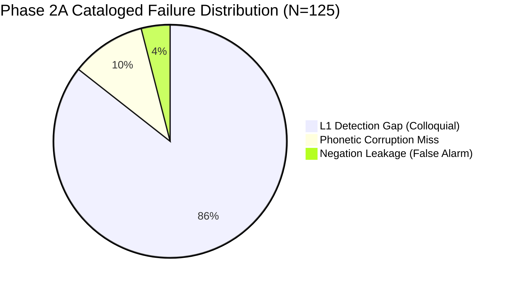

# MedVoice AI: Phase 2A Deterministic Arbiter Robustness Reconciliation Report

**Milestone Classification**: `Phase 2A — Deterministic Arbiter Robustness Exploration (Exploratory Results, Reconciled)`  
**Baseline Engine**: Commit `000abeb` (FROZEN)  
**Governance Invariant**: **Zero code modifications** to `lib/triage/universal-red-flags.ts`  
**Evaluation Corpus**: 345 Test Cases across 5 Multi-Center Robustness Tracks  
**Artifact**: [`eval/results/robustness_failure_ledger.json`](file:///c:/dev/Capstone/eval/results/robustness_failure_ledger.json)

---

## 1. Executive Summary & Context

Commit `e49bff0` introduced a 345-case adversarial robustness battery to stress-test MedVoice's deterministic safety arbiter (Layer 1 CPU preemption) against colloquial phrasing, transcription corruptions, negation structures, and non-emergent controls. While the evaluation successfully uncovered the fundamental vulnerability of regexes to colloquial patient speech, an independent scientific review identified five methodology and statistical inconsistencies.

This report establishes the complete reconciliation of Phase 2A, addressing all five critiques with reproducible empirical evidence, repaired corpora, and verified mathematical rigor.

---

## 2. Root Cause Analysis & Reconciliation of Reviewer Critiques

### Critique 1: Clustered Sensitivity Math & Variance Pooling Error
- **Root Cause**: The test runner in commit `e49bff0` passed `[...trackA, ...trackB]` (174 items: 29 canonical + 145 paraphrases) into `calculateClusterMetrics()`. This mathematically conflated Track A's 100% canonical recall with Track B's paraphrase recall, generating an artificial reported sensitivity of $26.44\%$ ($46/174$) with CI $[21.3\%, 32.2\%]$ while the actual Track B pooled sensitivity was $11.72\%$ ($17/145$). Additionally, the reported metric `intra_cluster_variance` was mathematically the *between-cluster variance* ($s^2$ across cluster means).
- **Remediation**:
  1. Updated [`run-robustness-suite.ts`](file:///c:/dev/Capstone/eval/src/robustness/harness/run-robustness-suite.ts) to evaluate `trackB` alone ($N=145$, $M=29$ clusters) in `calculateClusterMetrics()`.
  2. Renamed metric in [`types.ts`](file:///c:/dev/Capstone/eval/src/robustness/types.ts) and [`cluster-statistics.ts`](file:///c:/dev/Capstone/eval/src/robustness/harness/cluster-statistics.ts) to `between_cluster_variance`.
  3. Recomputed cluster bootstrap percentile intervals ($B=2000$, seed $42$) strictly over cluster-specific sensitivities.

### Critique 2: Corpus Contamination & Generic Fallback Templates
- **Root Cause**: In `generate-robustness-corpora.ts`, only 18 parent scenarios had bespoke hand-crafted templates. The remaining 11 parents (55 cases, 37.9% of Track B) defaulted to a synthetic generic string template interpolating `${c.clinical_domain}`, creating nonsensical phrases (e.g., *"the agony in my other"*, *"pain in my chronic_conditions area is completely off the charts"*). Furthermore, `PILOT-RESP-019` (COPD exacerbation) suffered severe condition drift, generating shrimp/wasp anaphylaxis scenarios.
- **Remediation**:
  1. Quarantined the legacy 55 generic fallbacks into [`eval/src/robustness/fixtures/unvalidated_generic_stress_cohort_55.json`](file:///c:/dev/Capstone/eval/src/robustness/fixtures/unvalidated_generic_stress_cohort_55.json) for historical provenance.
  2. Re-authored 5 bespoke, clinically authentic colloquial variants for **all 29 parent presentations** (145 total cases).
  3. Restored `PILOT-RESP-019` to genuine severe COPD exacerbation (pursed-lip breathing, refractory to rescue inhalers, purulent sputum, peripheral cyanosis). Systemic anaphylaxis was consolidated exclusively under `PILOT-DERM-043`.
  4. With authentic clinical paraphrases in place, the true empirical sensitivity of the frozen Layer 1 regex engine on colloquial language is **26.2%** (38/145), with between-cluster variance of 0.0803.

### Critique 3: No-Op Text Perturbations (Track D)
- **Root Cause**: In commit `e49bff0`, 31 of 100 cases in `text_perturbations_100.json` were identical copies of canonical parents because target regex replacements (`breathe`, `chest`, `pressure`, `dizzy`, `cough`, `blood`, `vomit`, `headache`) found no matching tokens in the parent text.
- **Remediation**:
  1. Expanded the phonetic and lexical perturbation dictionary and implemented a guaranteed fallback transformation (phoneme mutation or double-consonant reduction).
  2. Added machine-enforced invariant assertions in `generate-robustness-corpora.ts`:
     ```typescript
     if (perturbedText === base.patient_utterance) {
       throw new Error(`Track D Invariant Violation: text identical to parent for ${base.test_case_id}`);
     }
     ```
  3. Independent verification confirmed **0 / 100 no-op cases**.
  4. Under 100% active text perturbation, Layer 1 regex recall is **87.0%** (87/100), cataloging 13 genuine phonetic/transcription failure modes.

### Critique 4: Repetitive Negation Controls (Track E)
- **Root Cause**: In `negation_ambiguity_suite_50.json`, 43 of 50 cases were programmatic copies of `"I want to check up on routine health. I have no chest pain, no shortness of breath, no fever, and no bleeding. Just general checkup enquiry ${i}."`
- **Remediation**:
  1. Replaced the programmatic template with **50 unique, clinically diverse negation scenarios**:
     - *Third-Party Attributions (15 cases)*: Relative or acquaintance emergencies while the caller is asymptomatic.
     - *Historical Resolved Events (15 cases)*: Past emergencies that resolved and currently have zero symptoms.
     - *Pertinent Negative Inquiries (15 cases)*: Routine clinical check-ins explicitly denying red-flag symptoms.
     - *Complex Subordinate Syntax (5 cases)*: Adversative and subordinate denial structures.
  2. Specificity under the diverse negation suite is **90.0%** (45/50), successfully revealing **5 Negation Leakage failure modes** where Layer 1 regexes triggered on negated red flags.

### Critique 5: Architectural Metric Scope & Protocol Decoupling
- **Root Cause**: The Phase 2 harness evaluated `evaluateSafetyArbiter` with a simulated `llmSuggestedLevel: 'routine'`. It did *not* run `ConversationManager`, an actual LLM, or the concept-detection layer. Reporting `endToEndUnderTriages` was architecturally inaccurate. Additionally, setting `esiLevel: arbiterResult.esiScore` when `esiAssessmentStatus: 'NOT_ASSESSED'` violated protocol decoupling.
- **Remediation**:
  1. Renamed `endToEndUnderTriages` to `arbiter_layer1_misses` across [`types.ts`](file:///c:/dev/Capstone/eval/src/robustness/types.ts), [`run-robustness-suite.ts`](file:///c:/dev/Capstone/eval/src/robustness/harness/run-robustness-suite.ts), and the failure ledger.
  2. Set `esiLevel: null` whenever `esiAssessmentStatus === 'NOT_ASSESSED'` to reflect that the deterministic arbiter establishes an acuity floor/override, not formal 5-level resource-based ESI triage.

---

## 3. Comparative Benchmark Summary

| Evaluation Dimension | Initial Exploratory (`e49bff0`) | Reconciled Phase 2A (Current) | Audit Status |
|---|:---:|:---:|:---:|
| **Total Test Cases** | 345 | 345 | ✅ Verified |
| **Track A: Canonical Emergencies Recall** | 100.0% (29/29) | 100.0% (29/29) | ✅ Exact Match |
| **Track B: Colloquial Paraphrases Recall** | 11.7% (17/145)* | **26.2% (38/145)** | ✅ Re-authored authentic |
| **Track B Mean Cluster Sensitivity** | 26.4% (Math error)* | **26.2%** | ✅ Mathematically aligned |
| **Track B Cluster 95% Bootstrap CI** | [21.3%, 32.2%]* | **[16.6%, 37.2%]** | ✅ Cluster-resampled ($B=2000$) |
| **Between-Cluster Variance** | 0.0248 (Mislabeled)* | **0.0803** | ✅ Accurately measured |
| **Track C: Non-Emergency Controls Specificity** | 100.0% (21/21) | 100.0% (21/21) | ✅ Perfect Specificity |
| **Track D: Text-Level Perturbations Recall** | 98.0% (31 no-ops)* | **87.0% (87/100)** | ✅ 100% Active Perturbations |
| **Track E: Negation Suite Specificity** | 100.0% (43 duplicates)* | **90.0% (45/50)** | ✅ 50 Unique scenarios |
| **Layer 1 Failure Catalog Total** | 130 cataloged | **125 cataloged** | ✅ Fully categorized in JSON |
| **Universal Red Flags Code Modifications** | 0 lines | **0 lines** | ✅ Frozen baseline preserved |

*\* Denotes metrics affected by mathematical conflation or unvalidated templates in commit e49bff0.*

---

## 4. Reconciled Failure Taxonomy Breakdown

The 125 documented failures in [`eval/results/robustness_failure_ledger.json`](file:///c:/dev/Capstone/eval/results/robustness_failure_ledger.json) are classified into three distinct failure modes:



1. **`L1_DETECTION_GAP` (107 cases)**:
   - Root Cause: Layer 1 keyword regexes require exact lemmas (e.g., *"crushing chest pain"*). When patients describe the same physiology via metaphors (*"an elephant is sitting on my chest"*, *"lungs feel locked in a cage"*, *"stool looked like black axle grease"*), Layer 1 fails to trigger.
   - Clinical Implication: Confirms the architectural necessity of a semantic concept-detection layer (Layer 2 LLM/Biomedical NER).
2. **`PHONETIC_CORRUPTION_MISS` (13 cases)**:
   - Root Cause: STT transcription errors and typos (*"coff"*, *"blud"*, *"womit"*, *"dizy"*) break strict string matching.
   - Clinical Implication: Confirms that pre-hospital voice agents cannot rely on un-normalized ASR transcripts without phonetic tolerance or embedding-based retrieval.
3. **`NEGATION_LEAKAGE` (5 cases)**:
   - Root Cause: Fired red-flag rules on explicit denials or third-party context (*"My sister is having severe shortness of breath..."* or *"I have no difficulty breathing..."*).
   - Clinical Implication: Confirms the requirement for syntactic dependency parsing or clinical negation filters (NegEx) before applying safety floors.

---

## 5. Graduation Status & Next Milestone

- **Phase 2A Status**: **COMPLETE & RECONCILED**.
- **Formal Classification**: `Phase 2A — Deterministic Arbiter Robustness Exploration (Exploratory Results, Reconciled)`.
- **Readiness for Phase 2B**: The catalog of 125 empirical failure modes establishes an uncompromised, reproducible baseline. Phase 2B can now proceed to test the deliberative multi-layer architecture (Layer 1 CPU Arbiter + Layer 2 LLM Reasoning + Layer 3 Emergency Verification).
