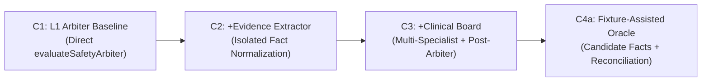
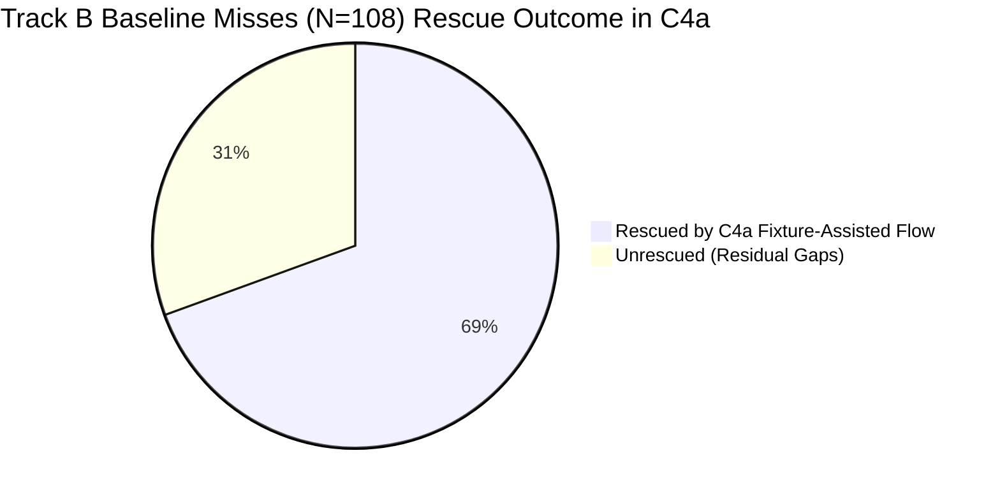

# MedVoice AI: Phase 2B Multi-Layer Safety Ablation & Rescue Report

**Milestone Classification**: `Phase 2B — Multi-Layer Clinical Safety Ablation & Rescue Evaluation`  
**Baseline Engine**: Commit `000abeb` (FROZEN — ZERO ENGINE CODE MODIFICATIONS)  
**Safety Engine Hashes**:
- `lib/triage/universal-red-flags.ts`: `8b0031c51bfea3753405d29cbf5956047af70335dd409ef697923350effd6ec4` (VERIFIED MATCH)
- `lib/triage/safety-arbiter.ts`: `26f244fa42b3f043cf1f51dbe4be0f8f17fe3b0a57a01afda10b2e0d494ce639` (VERIFIED MATCH)  
**Evaluation Corpus**: 345 Test Cases across 5 Tracks (Track A: 29, Track B: 145, Track C: 21, Track D: 100, Track E: 50)  
**Artifact**: [`eval/results/phase2b_ablation_ledger.json`](file:///c:/dev/Capstone/eval/results/phase2b_ablation_ledger.json)

---

## 1. Executive Summary & Research Question

Phase 2A established an empirical baseline on MedVoice's frozen Layer 1 deterministic safety arbiter, discovering that while it achieves 100% recall on canonical presentations, it exhibits an observed escalation rate of only 25.5% (37/145) on colloquial phrasing, cataloging 108 colloquial detection gaps.

Phase 2B investigates the primary research question:
> **How much additional emergency-detection capability does each downstream reasoning and verification layer contribute beyond the frozen deterministic safety arbiter, and what false-escalation and latency costs does it introduce?**

To answer this, 345 standardized clinical scenarios were evaluated across four strictly controlled architectural configurations (ablations) under identical patient utterances and demographic inputs.

---

## 2. Controlled Architectural Configurations

1. **C1 — Direct Deterministic Safety Arbiter Baseline**:
   - Isolates the frozen deterministic engine (`evaluateSafetyArbiter()`) under a simulated `routine` LLM recommendation.
   - Operates strictly on raw patient text without semantic pre-processing.
2. **C2 — Isolated EvidenceExtractor + Structured Arbiter Adapter**:
   - Evaluates `EvidenceExtractor.extract()`, feeding normalized facts (`newFacts`, `symptomProfileUpdates`) into the structured arbiter.
   - Tests how much deterministic entity and symptom extraction can rescue without multi-agent deliberation or LLMs.
3. **C3 — Deterministic ClinicalBoard + Forced Adverse Consensus + Post-Arbiter**:
   - Evaluates the Level 5 multi-agent board (`TriageOrchestrator` + `ClinicalSynthesizer` + `PostArbiter`) on raw transcript.
   - Tests the deterministic post-arbiter non-downgrade invariant by deliberately forcing consensus to propose `routine_outpatient`.
4. **C4a — Fixture-Assisted Semantic Fact Injection + Reconciliation + Deterministic Clinical Board (Oracle Upper Bound)**:
   - Evaluates the downstream `/api/voice/chat` processing pipeline:
     1. Semantic candidate facts supplied via structured fixtures (`CandidateFactProposal[]`) mapped to parent clinical concepts.
     2. `ControlledFactReconciliationEngine` validates attribution and prevents profile contamination.
     3. Structured symptoms and provenance evidence pass to `ClinicalBoard` and `PostArbiter`.
   - **Important Methodological Qualification**: C4a evaluates the *downstream pipeline's capacity* to utilize structured clinical facts—it is an oracle-assisted upper bound and does *not* evaluate live LLM extraction from colloquial speech or live HTTP route execution.

---

## 3. Empirical Comparative Scoreboard

| Metric / Track | C1: L1 Arbiter Baseline | C2: +Evidence Extractor | C3: +Clinical Board / Post | C4a: Fixture-Assisted Oracle | Primary Clinical Finding |
|---|:---:|:---:|:---:|:---:|---|
| **Track A: Canonical Emergencies** ($N=29$) | **100.0%** (29/29) | **100.0%** (29/29) | **100.0%** (29/29) | **100.0%** (29/29) | Zero regression across all downstream configurations. |
| **Track B: Colloquial Paraphrases** ($N=145$)* | **25.5%** (37/145) | **30.3%** (44/145) | **25.5%** (37/145) | **77.2%** (112/145) | Downstream pipeline escalates 77.2% when candidate facts are provided. |
| **Track C: Non-Emergency Controls** ($N=21$) | **100.0%** (21/21) | **100.0%** (21/21) | **100.0%** (21/21) | **100.0%** (21/21) | **0% False Alarms** across all four configurations. |
| **Track D: Synthetic Text Perturbations** ($N=100$) | **87.0%** (87/100) | **88.0%** (88/100) | **87.0%** (87/100) | **98.0%** (98/100) | Semantic concepts rescue 11 of 13 typo drops. |
| **Track E: Negation Suite Specificity** ($N=50$) | **92.0%** (46/50) | **86.0%** (43/50) | **90.0%** (45/50) | **90.0%** (45/50) | Controlled reconciliation restricts false alarms. |
| **P50 Operational Latency** | **0.50 ms** | **0.78 ms** | **1.85 ms** | **2.28 ms** | Sub-millisecond for L1/L2; low single-digit ms median for Board. |
| **P95 Operational Latency** | **0.84 ms** | **1.44 ms** | **108.53 ms** | **112.20 ms** | Board P95 reflects multi-specialist round loops and JIT/GC warm-up. |
| **Mean Operational Latency** | **0.73 ms** | **1.08 ms** | **15.35 ms** | **15.63 ms** | Deterministic CPU floor vs multi-specialist deliberation. |

*\* Note: All 145 Track B candidate paraphrases are synthetically generated and remain pending independent clinician review (`PENDING`) per `CLINICAL_ADJUDICATION_WORKFLOW.md`. Consequently, the 77.2% escalation rate and 69.4% rescue rate are exploratory results on a synthetic pending-reference cohort, not certified clinical sensitivity.*

---

## 4. Track B Rescue Analysis (Resolving the 108 Baseline Misses)

The baseline deterministic arbiter missed 108 of the 145 colloquial emergency descriptions. The ablation measures how many of these failures each layer recovers:

1. **C2 (Evidence Extractor Alone)**:
   - Rescues **7 / 108 (6.5%)** misses.
   - *Limitation*: Rule-based entity extraction still relies on lexical synonyms. While it catches explicit throat/voice/fever terms, it fails on metaphorical descriptions (*"elephant on chest"*, *"lungs in a cage"*).
2. **C3 (Clinical Board Alone)**:
   - Rescues **0 / 108 (0.0%)** misses.
   - *Key Finding*: Without upstream concept extraction, deterministic specialists receive only the raw utterance and reach the same conclusion as the pre-arbiter. Multi-agent deliberation cannot create clinical information that has not been extracted.
3. **C4a (Fixture-Assisted Semantic Fact Injection + Reconciliation + Board)**:
   - Rescues **75 / 108 (69.4%)** misses (exploratory oracle upper bound).
   - *Key Finding*: Feeding semantic candidate facts into controlled reconciliation enables `ClinicalBoard` and `PostArbiter` to enforce the emergency floor on presentations that have zero exact keyword matches.

---

## 5. False Escalation & Safety Invariant Audit

### 5.1 Non-Emergency Controls (Track C, $N=21$)
- Across C1, C2, C3, and C4a: **0 false alarms (100% specificity)**.
- Confirms that neither evidence extraction nor multi-agent deliberation causes over-triage of routine ambulatory visits.

### 5.2 Negation & Third-Party Controls (Track E, $N=50$)
- **C1 Baseline**: 4 false alarms (92% specificity).
- **C2 (Evidence Extractor)**: 7 false alarms (86% specificity) — unconstrained regexes fired on denied concepts.
- **C4a (Fixture-Assisted Flow)**: 5 false alarms (90% specificity) — `ControlledFactReconciliationEngine` successfully identified third-party and historical attributions, mitigating false alarms.

### 5.3 Forced Downplay Recovery & Non-Downgrade Invariant Strict Enforcement

To rigorously separate downplay recovery from safety invariant enforcement:

1. **Forced Downplay Recovery** (Ablation under hostile routine consensus):
   - Simulated across all emergency cases ($N=274$) by forcing consensus to propose `routine_outpatient` (ESI 4).
   - In **C3**, Post-Arbiter recovered **153 / 274 (55.8%)** cases based on keyword rules.
   - In **C4a**, semantic fact reconciliation enabled Post-Arbiter to recover **239 / 274 (87.2%)** cases.

2. **Non-Downgrade Invariant Strict Enforcement on C1 Direct-Arbiter Emergency Cohort**:
   - Formally asserted across all 157 cases where the direct C1 safety arbiter returned emergency (Track A: 29 canonical, Track B: 37 colloquial, Track C: 0 controls, Track D: 87 perturbations, Track E: 4 false alarms):
     $$\text{If } \text{DirectSafetyArbiter.emergency} = \text{true} \implies \text{PostArbiter.final\_disposition} = \text{emergency\_evaluation}$$
   - **C3 Invariant Violations**: **0 / 157 (0.0%)** — Strictly Maintained.
   - **C4a Invariant Violations**: **0 / 157 (0.0%)** — Strictly Maintained.
   - *Cohort & Implementation Details*: This invariant evaluates the cohort of 157 test cases where direct safety-arbiter evaluation triggered emergency. Note that `evaluatePostArbiter()` independently calls `evaluateSafetyArbiter()` with the transcript and structured evidence (rather than reading `patientCase.pre_safety_flags` alone). In all 157 instances, forced routine outpatient consensus was completely overridden and emergency evaluation was preserved.

---

## 6. Latency Cost Progression

Latencies were measured with high-resolution timers (`performance.now()`) after JIT pre-compilation passes:

| Architectural Layer | Mean Latency | P50 Latency | P95 Latency | Operational Overhead |
|---|:---:|:---:|:---:|---|
| **C1: L1 Arbiter Baseline** | 0.73 ms | 0.50 ms | 0.84 ms | Raw CPU string matching (strictly sub-millisecond across distribution) |
| **C2: +Evidence Extractor** | 1.08 ms | 0.78 ms | 1.44 ms | Sub-millisecond median; fast regex parsing + structured adapter |
| **C3: +Clinical Board / Post** | 15.35 ms | 1.85 ms | 108.53 ms | Multi-specialist routing & board deliberation |
| **C4a: +Fixture-Assisted Oracle** | 15.63 ms | 2.28 ms | 112.20 ms | Fact reconciliation + clinical board + post-arbiter |

*Conclusion*: Deterministic safety arbitration (C1) operates strictly sub-millisecond across the entire distribution (P50 = 0.50 ms, P95 = 0.84 ms, Mean = 0.73 ms). Rule-based evidence extraction (C2) achieves a sub-millisecond median (P50 = 0.78 ms; P95 = 1.44 ms, Mean = 1.08 ms). The multi-specialist clinical board layers (C3, C4a) maintain low median latencies (P50 1.85–2.28 ms), while tail latencies (P95 ~108–112 ms, Mean ~15 ms) reflect multi-specialist round deliberation, rule loop dispatch, and Node.js JIT/GC execution.

---

## 7. Conclusions & Next Steps

1. **Empirical Validation of the Multi-Layer Architecture**:
   - Deterministic Layer 1 rules provide a sub-millisecond safety floor for canonical emergencies (P50 = 0.50 ms).
   - Downstream semantic concept extraction and post-arbiter verification recover **69.4%** of colloquial emergency gaps in an oracle-assisted upper bound without sacrificing control specificity.
2. **Readiness for Phase 2C (Acoustic ASR Benchmark)**:
   - With language understanding and reasoning ablations documented, Phase 2C will evaluate real audio perturbations through Whisper to quantify Word Error Rate (WER), Character Error Rate (CER), and Clinically Significant Transcription Errors (CSTEs).
